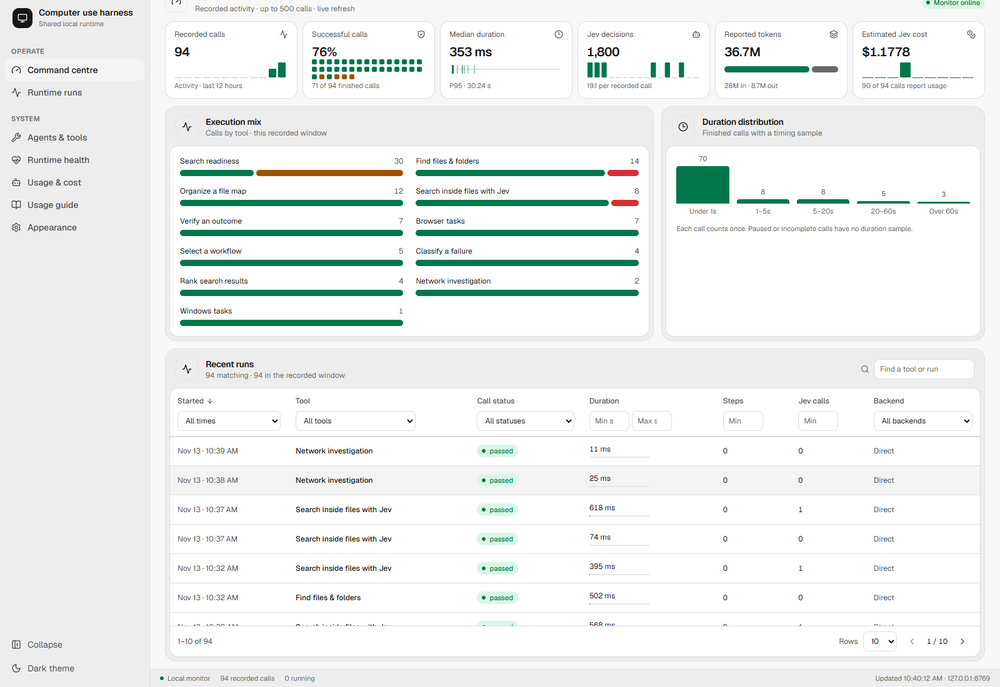
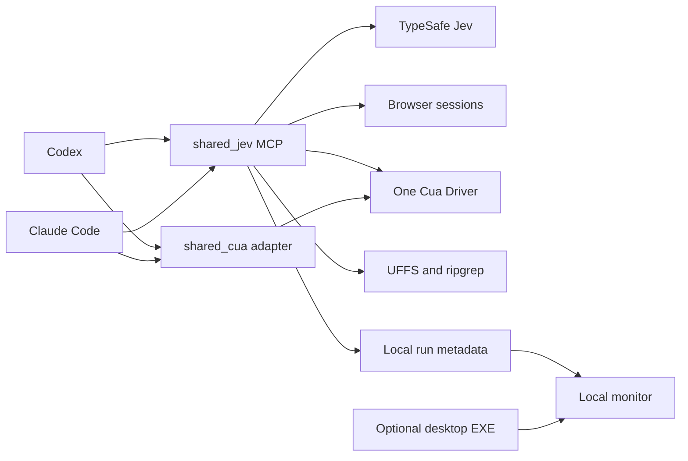
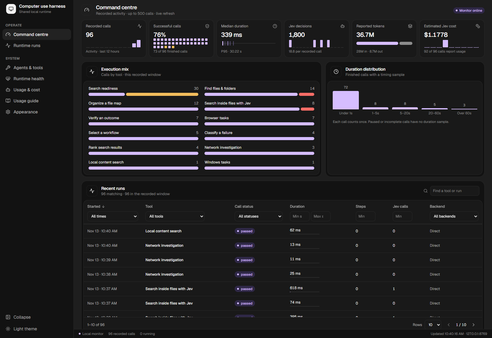

# Nexus Harness

Nexus gives Codex and Claude Code a shared set of Windows tools for finding files, searching text, using browsers and desktop apps, investigating networks, and making bounded decisions with TypeSafe Jev. Its local monitor shows tool activity and component health.

**Start here:** [What to download](#what-to-download) · [Install the harness](#install-the-harness) · [Open the desktop app](#open-the-desktop-app) · [Connect Codex and Claude](#connect-codex-and-claude-code) · [Verify the installation](#verify-the-installation) · [Troubleshooting](#troubleshooting)



## What to download

Get the downloads from [GitLab releases](http://10.2.6.112:8080/ssm/shared-computer-use/-/releases). The office link uses the GitLab LAN address; outside the office, connect to the same GitLab through its [Tailscale address](http://100.110.236.122:8080/ssm/shared-computer-use/-/releases) when reachable. Authenticate to GitLab if prompted. GitLab also lists source-code archives automatically; they are not installation packages.

| Download | What it does |
|---|---|
| **Windows x64 deployment ZIP** | The harness: setup scripts, Node runtime, browser and desktop tooling, search components, monitor, dependencies, and agent instructions. Use this for a new installation. |
| **Nexus desktop EXE (Windows x64)** | An optional window for the monitor on a machine where the harness is already installed. It does not install or configure the harness. |
| **SHA256 files** | Checksums for verifying the respective downloaded ZIP and EXE. |

The desktop EXE and deployment ZIP are separate downloads. The EXE is a preliminary self-contained .NET application: it needs the existing Nexus monitor and Microsoft Edge WebView2 Runtime. It does not include an installer, automatic updater, or the harness itself. A browser can always open the monitor at `http://127.0.0.1:8769/` instead.

## Requirements

- Windows 11 x64, an interactive user session, and Windows PowerShell 5.1.
- Codex and/or Claude Code installed and signed in separately. Nexus does not install or authenticate these agents.
- Your own TypeSafe API key for Jev-backed tools. Key enrollment and provider authentication are separate checks.
- Chrome or Edge for browser tasks. Deployment setup attempts to install Chrome through WinGet if neither is detected.
- Microsoft Edge WebView2 Runtime for the optional desktop EXE.
- Internet access for Jev and any required downloads. The monitor itself runs locally. Installing the UFFS search broker can prompt for administrator approval.

The deployment ZIP includes its own Node, Cua Driver, UFFS and ripgrep executables and locked npm dependencies. Docker, WSL, a local model, a GPU, and a separate Python environment are not required.

## Install the harness

These steps describe release **v1.7.2**. For a later release, use its ZIP and matching checksum names. Perform setup as the Windows user who will run the agents. If Nexus is already configured, read [Updates and rollback](#updates-and-rollback) before replacing or moving anything.

1. Download **Windows x64 deployment ZIP** and its **SHA256 checksum** from the release page. The following example assumes both are in your Downloads folder.
2. Open Windows PowerShell 5.1. If local execution policy prevents the included scripts from running, start a temporary session with `powershell.exe -NoProfile -ExecutionPolicy Bypass`; this does not change the machine's execution policy. Compare the downloaded archive's hash with the first value in the checksum file. They must match before extraction:

   ```powershell
   $zip = Join-Path $env:USERPROFILE 'Downloads\nexus-v1.7.2-windows-x64.zip'
   $checksum = Join-Path $env:USERPROFILE 'Downloads\nexus-v1.7.2-windows-x64.zip.sha256'
   $expected = ((Get-Content -LiteralPath $checksum -Raw).Trim() -split '\s+')[0]
   (Get-FileHash -LiteralPath $zip -Algorithm SHA256).Hash -eq $expected
   ```

   Continue only when the result is `True`.

3. Extract the complete ZIP into a stable ordinary folder outside AppData. The archive contains a `shared-computer-use` folder:

   ```powershell
   Expand-Archive -LiteralPath $zip -DestinationPath (Join-Path $env:USERPROFILE 'Documents\Nexus-Harness')
   Set-Location (Join-Path $env:USERPROFILE 'Documents\Nexus-Harness\shared-computer-use')
   ```

4. Run setup and enter your TypeSafe key at the masked prompt:

   ```powershell
   powershell.exe -NoProfile -ExecutionPolicy Bypass -File .\Setup.ps1 -EnrollKey
   ```

   Accept the UFFS broker elevation prompt if one appears. Setup checks bundled runtime hashes and dependencies, configures the broker and Cua Driver, checks the package, attempts to add missing agent registrations, installs the managed skill where agent folders exist, and configures monitor startup. Existing registrations and unrelated skills are preserved. If an existing monitor task belongs to another installation, setup stops instead of replacing it.

5. Restart or reconnect your Codex and Claude sessions. Then follow [Connect Codex and Claude Code](#connect-codex-and-claude-code) and [Verify the installation](#verify-the-installation). Setup finishing does not prove a real search, authenticated Jev call, browser task, or desktop action has succeeded.

If you need to enroll or replace the key later, run `.\Set-ComputerUseKey.ps1` in Windows PowerShell. It prompts securely. A separate `TYPESAFE_API_KEY` environment variable can supply the default when the encrypted default file is absent. Reconnect agents after changing the key.

## Open the desktop app

1. Complete the harness installation above and confirm the monitor is running. Download **Nexus desktop EXE (Windows x64)** and its separate EXE checksum from the same release.
2. For v1.7.2, compare the EXE with its checksum file in Downloads. Continue only when the result is `True`:

   ```powershell
   $exe = Join-Path $env:USERPROFILE 'Downloads\Nexus.Desktop.exe'
   $exeChecksum = Join-Path $env:USERPROFILE 'Downloads\Nexus.Desktop.exe.sha256'
   $expectedExe = ((Get-Content -LiteralPath $exeChecksum -Raw).Trim() -split '\s+')[0]
   (Get-FileHash -LiteralPath $exe -Algorithm SHA256).Hash -eq $expectedExe
   ```

   Save the verified EXE in a stable folder and double-click it. It is a portable executable; no installation wizard or shortcut is created.
3. The window connects to the existing monitor at `http://127.0.0.1:8769/`. If the monitor is stopped, it attempts to start the existing `SharedHarness-Monitor` scheduled task. If that task is missing, run harness setup first. Close the window normally when finished.

The desktop window has its own WebView2 state under `%LOCALAPPDATA%\Nexus\WebView2`. It is not a second MCP server, does not install or update the harness, and does not configure Codex or Claude. It has been launched against the existing monitor on the owner's laptop; fresh-machine installation, task startup from the EXE, and broad desktop acceptance remain unverified.

## Connect Codex and Claude Code

Both agents should use the same installed Nexus services:

- `shared_jev` is the Nexus MCP server for the tools below. Each agent can launch its own adapter process.
- `shared_cua` is a direct adapter to the same Cua Driver named pipe; it is not another desktop driver.
- The `shared-harness` skill tells agents when and how to use the tools. It is distinct from the MCP registrations.

### Check automatic setup

`Setup.ps1` attempts registration only for agent commands visible on its PATH. It leaves existing entries untouched, which may mean they still point at another installation. Run these checks for the agents you use:

```powershell
codex mcp get shared_jev
codex mcp get shared_cua
claude mcp get shared_jev
claude mcp get shared_cua
```

Check that the executables and `jev-use\start.mjs` resolve to the intended installation. If the `codex` or `claude` command is unavailable, start the appropriate agent CLI or add its supported executable to your shell PATH; installing a skill folder alone does not install an MCP server. On this laptop the Codex CLI can also be invoked as `C:\Users\Admin\.codex\.sandbox-bin\codex.exe`. Paths on another machine may differ.

If setup stopped while checking a missing registration, a laptop validation reported that `codex mcp get` stderr could become a terminating PowerShell `NativeCommandError`; manual registration succeeded there. Inspect the actual error and existing entries first. Do not remove or overwrite another registration blindly.

### Add missing registrations manually

The following examples assume the deployment ZIP location from the installation steps. Change `$nexus` if you installed it elsewhere. Run only the commands for **missing** registrations; investigate an existing entry that points elsewhere before changing it.

```powershell
$nexus = Join-Path $env:USERPROFILE 'Documents\Nexus-Harness\shared-computer-use'
codex mcp add shared_jev -- "$nexus\runtime\node.exe" "$nexus\jev-use\start.mjs"
codex mcp add shared_cua -- "$nexus\runtime\cua-driver.exe" mcp --socket '\\.\pipe\cua-driver'
```

```powershell
$nexus = Join-Path $env:USERPROFILE 'Documents\Nexus-Harness\shared-computer-use'
claude mcp add -s user shared_jev -- "$nexus\runtime\node.exe" "$nexus\jev-use\start.mjs"
claude mcp add -s user shared_cua -- "$nexus\runtime\cua-driver.exe" mcp --socket '\\.\pipe\cua-driver'
```

Inspect both entries again with `mcp get`, then restart or reconnect each agent so it discovers the current server. If setup stopped before completing monitor and skill setup, rerun `powershell.exe -NoProfile -ExecutionPolicy Bypass -File .\Setup.ps1 -EnrollKey` from the harness folder and verify its output. This prompts for the key; omit `-EnrollKey` if it was already enrolled for this installation. Setup installs the packaged skill when it detects each agent's profile folder. To install a missing skill or refresh one managed by this installation:

```powershell
.\Install-Skills.ps1
.\Install-Skills.ps1 -Update
```

The update switch refuses to replace an unrelated or differently managed skill. Point agents to [AGENTS.md](AGENTS.md), [USAGE.md](USAGE.md), and the installed `shared-harness` skill; ask them to use `shared_jev` and `shared_cua` for supported tasks. Registration or a listed tool alone is not proof that the agent can perform an authenticated task.

## Verify the installation

From the installed `shared-computer-use` folder:

```powershell
.\Harness.ps1 tools
.\Harness.ps1 status
.\Harness.ps1 call -Tool find_files -Arguments '{"pattern":"Harness.ps1","kind":"file","limit":10}'
.\Monitor.ps1 Status
.\Diagnose.ps1
```

`tools` lists the live MCP catalog. `status` reports search readiness, not a completed search. The bounded `find_files` query should return an appropriate match on an indexed drive; inspect its status, coverage, truncation and errors. First use can take longer while UFFS starts. Search may legitimately be idle when not in use. An empty result does not prove a file is absent from an uncovered or stale index.

`Diagnose.ps1` checks the catalog, search status, Cua Driver and monitor, and reports whether the default key file exists without decrypting it. It does not authenticate to Jev or perform a UI action. After reconnecting, ask each agent to use a harmless `find_files` query and, where authorized, a bounded browser or Calculator task with an explicit expected result. Confirm the actual returned evidence. Authenticated Jev calls can consume API credit; a successful setup, green monitor, existing key or visible tool name is not an end-to-end test.

For other invocations, use the same implementation through the CLI:

```powershell
.\Harness.ps1 call -Tool jev_browse -Arguments '@browser-task.json'
```

Quote `@filename` in PowerShell 5.1 so it is passed as an argument rather than treated as splatting. See [USAGE.md](USAGE.md) for the current inputs, examples, limits and expected outcomes.

## Tools

The live `tools` catalog is authoritative. The current baseline is:

| Tool | Use |
|---|---|
| `find_files` | Find file and folder names through the UFFS NTFS metadata index. |
| `search_status` | Inspect index readiness, drive coverage and memory. |
| `search_local` | Search file contents locally, including large files, with bounded results. |
| `jev_search_content` | Find scoped text and send selected excerpts to Jev for ranking. |
| `network_probe` | Inspect local network information or explicitly requested hosts, ports, URLs or IPv4 subnet. |
| `map_files` | Build file maps, review pages and dry-run organization proposals; it does not move files. |
| `jev_browse` | Run a bounded Chrome or Edge task with an explicit goal and expected text. |
| `jev_desktop` | Run a bounded accessibility-based Windows task against an identified app and expected state. |
| `jev_select_workflow` | Recommend a workflow for a supplied request. |
| `jev_rank_results` | Rank caller-supplied candidates. |
| `jev_classify_failure` | Classify supplied failure evidence and recommend a recovery. |
| `jev_verify_result` | Judge whether supplied evidence supports a requested outcome. |

The four decision tools return judgments or recommendations; they do not execute a workflow or independently observe the application. A null or uncertain result is valid. Give browser and desktop tasks a specific target and end condition. An inaccessible control, ambiguous target, challenge or step limit can stop the task; inspect the actual result rather than assuming success.

`search_local` keeps its search results local; `jev_search_content` can send selected excerpts to TypeSafe. Both have limits and can report truncation, errors or inaccessible files. Neither is general PDF, Office or OCR extraction. `network_probe` only performs requested active probes; a missing ICMP reply does not prove a host is absent. See [USAGE.md](USAGE.md) for scope and limits.

## How the pieces fit



The driver uses `\\.\pipe\cua-driver` in the interactive Windows session. Browser profiles and named sessions are local and separate from personal browser profiles. Named Playwright sessions have cross-process locks; `session_busy` means the session is in use, not permission to delete its lock. Serialize desktop and legacy CDP requests across agents; their arbitration is not complete. Use an existing API for deterministic operations and Nexus tools for the supported computer-use and search tasks.

## Monitor and day-to-day operation

Open the desktop EXE or use a browser at `http://127.0.0.1:8769/`. From the harness folder:

```powershell
.\Monitor.ps1 Open
.\Monitor.ps1 Status
.\Harness.ps1 monitor
```

The monitor shows recorded runs, timings, token and estimated-cost information, the tool catalog, and runtime health. It reads a bounded recent metadata window: up to 500 calls from a 256 KiB log tail. Refresh and component observations have different intervals. Missing usage is unknown, not zero; the historical cost estimate is not an invoice. Direct Cua actions outside the wrapper are not necessarily recorded.

| Capability catalog | Runtime health |
|---|---|
|  |  |

<details><summary>More monitor views</summary>




</details>

The screenshots show a particular local run; counts and health differ on each machine. [UI provenance](monitor-ui/PROVENANCE.md) describes the reused components.

`SharedHarness-Monitor` starts its hidden host at user sign-in. The host restarts an unexpected server exit after three seconds, up to its configured limit; the default browser opens once per sign-in session, not after each recovery. The machine must be on and the user signed in. `Monitor.ps1 Start` starts or reuses the monitor; `Open` also opens a browser. An intentional stop suppresses recovery for that stop while preserving the next sign-in task:

```powershell
.\Monitor.ps1 Stop
```

Removing the startup task is a separate operation. `InstallStartup` checks task ownership and will not take over another installation. A responding monitor is not proof that a browser, search, desktop action or paid Jev request works. Its read-only server binds to loopback; the separate `map_files` review server has different behavior and port.

## Keys, privacy and cost

The default key is stored in `secrets\computeruse_1.xml`, encrypted with Windows DPAPI for the current Windows account. Do not put key values in source control, release bundles, logs or instructions. Keep the installation's secrets, browser profiles, sessions and run history on the same account and machine unless deliberately migrated. Codex and Claude authentication is separate from the TypeSafe key.

Optional per-tool aliases let tools share or use different TypeSafe keys. Enroll each alias at a masked prompt:

```powershell
.\Set-ComputerUseKey.ps1 -Alias browser_team
.\Set-ComputerUseKey.ps1 -Alias decisions_team
```

Create `secrets\tool-keys.json` with aliases, never key values:

```json
{
  "jev_browse": "browser_team",
  "jev_desktop": "browser_team",
  "jev_verify_result": "decisions_team"
}
```

Unmapped tools use the default key. An invalid or missing mapped alias fails the relevant call rather than silently choosing another key. Reconnect agents after enrollment or mapping changes. Runtime health reports default enrollment, not successful authentication or the health of every mapping. Actual multi-key live authentication has not been established by the release checks.

Jev-backed requests can send task descriptions, selected control state and excerpts to TypeSafe; provide only information appropriate for the task. The monitor's compact wrapper metadata does not record task text, field values, screenshots or keys. A monitor cost estimate can be partial and excludes other providers.

## Updates and rollback

An update is not an automatic replacement. Download and verify the newer deployment ZIP, keep the old installation for rollback, and stop agents using the old installation before replacing held executables or dependencies. Existing registrations, scheduled tasks, encrypted keys, profiles and sessions are tied to paths and/or the Windows account. Setup preserves conflicting entries and tasks instead of silently migrating them. Inspect their current paths, update them deliberately for the chosen installation, refresh managed skills when appropriate, and reconnect agents. Keep the prior installation and user data until the new setup and intended workflows have been checked. Roll back by restoring the previous registrations and task paths; do not delete working data as a shortcut.

The desktop EXE is distributed separately from the ZIP. Updating the ZIP does not update the EXE, and replacing the EXE does not update the harness. There is no desktop auto-update mechanism in this release.

## Troubleshooting

| Symptom | What to check |
|---|---|
| Desktop EXE says the monitor could not open | Run `.\Monitor.ps1 Status` from the harness folder, then `Start` if appropriate. Confirm `SharedHarness-Monitor` belongs to this installation and WebView2 Runtime is available. |
| Monitor is unavailable or startup times out | Inspect the task state, its last result and `monitor-error.log`. Another installation may own the task or port; preserve it until you decide how to migrate. |
| Monitor runs outside its managed task | For the same installation, stop it with `.\Monitor.ps1 Stop`, then run `.\Monitor.ps1 InstallStartup`; inspect ownership first. |
| Codex or Claude cannot see a tool | Check `mcp get` for `shared_jev` and `shared_cua`, their launcher paths, the installed skill, and whether the agent has been reconnected. |
| Setup stops on a missing Codex registration | Inspect the error and entries; the reported PowerShell `NativeCommandError` case and manual registration commands are described above. |
| Jev key is missing or rejected | Enroll the key using the masked prompt and reconnect the MCP process. Key presence does not establish successful authentication. Never paste it into diagnostics. |
| Search shows idle or returns no match | Run a bounded search and check drive coverage, freshness and errors. UFFS may be parked or still warming; absence from an uncovered drive is not proof of absence. |
| Browser or desktop task does not complete | Inspect the returned reason, target, expected result, challenge, step limit and time limit. A successful synthetic form does not prove every site or desktop application works. |
| Source setup refuses existing `node_modules` | It intentionally preserves unverified or changed dependencies. Stop agents using the installation and use a fresh checkout; do not run `npm ci` over an active directory. |
| A component was installed but is not found | Reconnect the shell/agent and inspect its PATH. Source setup can also find the standard UFFS WinGet package path. |

## Source, development and release

GitLab [Nexus Harness](http://10.2.6.112:8080/ssm/shared-computer-use) is the development upstream; its repository path remains `ssm/shared-computer-use`. A separate public source snapshot is available at [GitHub: Nexus](https://github.com/bhadkamkar9snehil/Nexus). GitLab runs CI; GitHub has no CI or automatic synchronization. Screenshot links are relative on both hosts.

For source setup, install Git, Node 22 or later, npm, Codex and/or Claude, and the Windows prerequisites. Clone the repository to an ordinary folder outside AppData, then from the checkout:

```powershell
.\Install.ps1 -InstallDriver -InstallSearch -RegisterAgents
.\Set-ComputerUseKey.ps1
.\Install-Skills.ps1
.\Monitor.ps1 InstallStartup
```

Source setup stages dependency restoration and preserves a conflicting existing `node_modules`. The same registration checks, reconnects and actual workflow verification apply. The source is not the deployment ZIP; it does not bundle all runtimes by itself.

The desktop host source is in `desktop/`. Building it requires the .NET 10 SDK; running it requires WebView2 and an existing monitor. The published EXE is a separate release asset. A source build is not an installer:

```powershell
dotnet build .\desktop\Nexus.Desktop.csproj --configuration Release
```

For changes, run the relevant package, reference and UI checks; see [VALIDATION.md](VALIDATION.md). `Test-Package.ps1` checks TypeScript, monitor syntax and MCP discovery. `npm --prefix jev-use test` runs the reference/unit suite; rendered monitor checks and live browser/desktop probes are separate and may interact with apps or spend API credit. Clean teammate-machine setup, real authenticated tasks from both agents, and signed-in browser persistence still require destination acceptance.

Follow branch → GitLab MR → observed green Windows pipeline → merge → annotated release tag. `Build-Deployment.ps1 -Version vX.Y.Z` stages the merged source, restores dependencies, builds the monitor, verifies runtimes and makes the ZIP. It uses 7-Zip when available and otherwise the .NET ZIP implementation. Verify extraction using bundled Node, upload the ZIP and checksum to the GitLab package registry, compare the registry hash, and link the assets from the release. Publish and verify a desktop EXE separately when one is included. Do not include credentials, browser profiles, sessions or run history.

Further references: [operator and tool contracts](USAGE.md) · [agent instructions](AGENTS.md) · [validation and limits](VALIDATION.md) · [third-party software](THIRD_PARTY.md) · [search research](SEARCH-RESEARCH.md).
