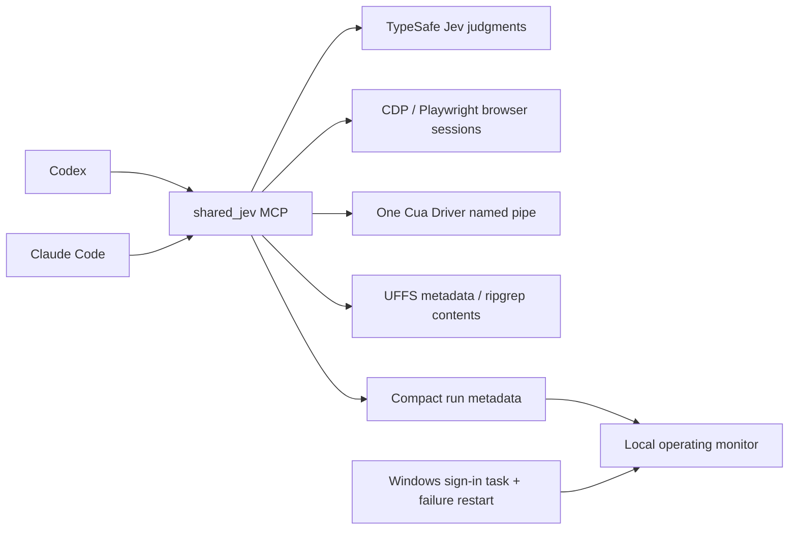

# Nexus — shared agent harness

One Windows-native package for Codex and Claude: Jev decisions, browser and desktop automation, file discovery and content search, network investigation, and a local operating monitor. Both agents call the same tools and reuse the same services. No Docker, WSL, local models or GPU inference.

**Start here:** [Install and operate](#install) · [Give this to your agent](#agent-onboarding) · [Tool contracts](#tools) · [Detailed guide](USAGE.md) · [Validation](VALIDATION.md) · [Releases](http://10.2.6.112:8080/ssm/shared-computer-use/-/releases)


## Monitor

The monitor opens at **http://127.0.0.1:8769/**. Its hidden Windows task starts at user sign-in and owns the long-running host. That host restarts an unexpected server exit after three seconds, up to999 times. The default browser opens once per Windows sign-in session; recovery does not repeatedly open tabs. An intentional Stop is respected.

The connection badge proves the monitor responds. Runtime health separately reports the driver, browser installation, UFFS/broker, Jev credential enrollment, and monitor startup configuration. It does not claim a paid API request or desktop/browser task passed merely because a component is installed.

- Six thin KPI instruments show recorded calls, successful calls, median/P95 duration, Jev decisions, reported tokens and estimated cost.
- Execution mix and duration distributions use recorded metadata, not example data.
- Recent runs have internal scrolling, sticky column filters, sorting, pagination, duration bars and readable details. Filter time, tool, call status, duration, steps, Jev calls and backend.
- Agents & tools has a searchable capability catalog, categories, parameter tables, per-tool activity and detected MCP registrations.
- Runtime health shows named states, metrics and next actions. No raw JSON or schemas appear in the product UI.
- Original Chitragupta components, Geist fonts, light/dark themes and seven accent swatches are retained. Assets are local; no runtime CDN or frontend dev server.

| Capability catalog | Runtime health |
|---|---|
|  |  |

<details><summary>Dark theme preview</summary>


</details>

Screenshots show an actual local installation and a bounded recorded window. Counts, cost estimates, registrations and readiness differ per machine. [UI provenance](monitor-ui/PROVENANCE.md) records the reused source and GitLab references.

The repository also contains a preliminary Windows desktop host for the monitor in `desktop/`. With the .NET 10 SDK and WebView2 runtime installed, build it using `dotnet build desktop/Nexus.Desktop.csproj --configuration Release`. It uses the existing monitor and its managed startup task. It is not included in the deployment ZIP and has no installer or updater; the existing browser monitor and installation remain the supported path.

## Install

### Deployment ZIP — recommended

Requirements: Windows11 x64, an interactive user session, your own TypeSafe API key, and installed Codex and/or Claude Code. Chrome or Edge is required; setup attempts a Chrome WinGet installation if neither is found. Broker setup can require elevation. Agent installation and agent authentication are separate prerequisites.

1. Download the newest Windows x64 ZIP and checksum from [GitLab releases](http://10.2.6.112:8080/ssm/shared-computer-use/-/releases). Verify its SHA256 with `Get-FileHash`.
2. Extract completely into a stable ordinary folder, for example `C:\Users\YourName\Documents\shared-computer-use`. **Avoid AppData**: packaged agents can see virtualized copies there.
3. Open Windows PowerShell5.1 in that folder:

```powershell
.\Setup.ps1 -EnrollKey
```

Setup verifies runtime hashes and bundled dependencies, provisions UFFS broker access and Cua startup, validates the package, adds missing MCP registrations, installs the packaged skill where the agents are present, and configures managed monitor startup. Enter the key at the masked prompt. Reconnect the agents afterward.

Existing MCP entries and existing skills are preserved. A warning means they may still point to an older installation; compare the paths and migrate deliberately. Startup tasks belonging to another installation are preserved with an error. Do not move the installation directory after setup without updating its references.

The ZIP includes Node22.22.0, Cua Driver0.38.0, UFFS0.6.47, ripgrep15.1.0, Playwright CLI0.1.24, restored locked npm dependencies, compiled UI, local fonts, guides and the skill. It excludes credentials, browser profiles, sessions and run history. Network is needed for Jev calls and any browser download, not for rendering the monitor.

### Source checkout

Requires Git, Node22+ and npm in addition to the Windows prerequisites:

```powershell
git clone https://github.com/bhadkamkar9snehil/Nexus.git
Set-Location .\Nexus
.\Install.ps1 -InstallDriver -InstallSearch -RegisterAgents
.\Set-ComputerUseKey.ps1
.\Install-Skills.ps1
.\Monitor.ps1 InstallStartup
```

The public source is also available at [GitHub: Nexus](https://github.com/bhadkamkar9snehil/Nexus). Outside the office, the GitLab repository is available at `http://100.110.236.122:8080/ssm/shared-computer-use.git`.

Source setup prints the installation path, Node and driver locations, UFFS PATH visibility, broker and monitor task state, and credential-file presence without decrypting it. A missing UFFS command immediately after WinGet installation can mean the current process has stale PATH; reconnect the agent and verify the installed package and broker. Source dependency restore runs in a separate staging directory. A matching recorded lockfile is reused; an existing unrecorded or different `node_modules` is preserved and setup stops. For updates, stop agents using that installation and use a fresh checkout rather than running `npm ci` over a held executable. Setup does not move credentials, profiles or run history.

## Agent onboarding

Point a teammate's Codex or Claude at **[AGENTS.md](AGENTS.md)**. Claude also loads **[CLAUDE.md](CLAUDE.md)**, which imports it. A focused, portable **[shared-harness skill](skills/shared-harness/SKILL.md)** ships with its own tool reference; Setup installs it in the local Codex/Claude skill directories when present.

Paste this into the teammate's agent:

> Read AGENTS.md and README.md in this repository, then follow USAGE.md to inspect and set up this Windows machine. Preserve existing MCP entries, browser profiles and services. Enroll the TypeSafe key securely. Verify the local monitor, tool catalog, search status, and safe browser/Calculator probes. Use the installed shared_jev tools for subsequent browser, desktop and file-search tasks. Report actual results and remaining acceptance gaps; do not create a separate automation engine or claim configuration alone proves task success.

Install or deliberately update the managed skills:

```powershell
.\Install-Skills.ps1
.\Install-Skills.ps1 -Update
```

The update switch only replaces a skill managed by this same installation. It refuses an unrelated skill. Both agents discover the same `shared_jev` MCP interface. `shared_cua` connects directly to the same driver for diagnostic/batched operations. Reconnect running agent sessions after installation or a tool update.

## Tools

The live catalog is authoritative; the maintained baseline has twelve tools:

| Tool | Purpose | Main inputs |
|---|---|---|
| `find_files` | UFFS indexed file/folder metadata; optional Jev best match | pattern; drive, kind, limit, path_filter, query |
| `search_status` | Search readiness, coverage and memory | none |
| `jev_search_content` | Scoped literal ripgrep retrieval and Jev excerpt selection | root, pattern, query |
| `search_local` | Local-only content search, including large files | root, pattern; glob, regex, limit |
| `network_probe` | Network interfaces and explicitly scoped discovery and endpoint tests | host, ports, subnet, url, system, ping, trace, tls_port, timeout_ms |
| `map_files` | Project/file maps, review pages and dry-run root proposals | action, roots, out_dir, limit_units, open |
| `jev_browse` | Automatically launch/reuse Chrome or Edge for a bounded task | goal, url, expect_text; browser, backend, session, fields, max_steps |
| `jev_desktop` | Bounded Windows accessibility-control task | goal, app, expect; launch_aumid, window_id, text, max_steps |
| `jev_select_workflow` | Recommend a workflow for an uncertain request | request, context |
| `jev_rank_results` | Rank supplied candidate excerpts | query, candidates |
| `jev_classify_failure` | Classify observed errors; recommend recovery | operation, evidence |
| `jev_verify_result` | Judge whether supplied evidence satisfies a request | request, evidence |

Prefer existing APIs or deterministic batches for known operations. Jev selects bounded uncertain actions; existing executors perform them. The four decision tools do not execute their recommendations. Null/uncertain is a valid result. An already satisfied task or metadata/status operation can legitimately make zero Jev calls.

`search_local` keeps search results on the machine, accepts files larger than 4 MiB, and reports limits and errors. `jev_search_content` sends selected excerpts to TypeSafe and retains its smaller limits. `network_probe` performs only the explicitly requested active checks; ICMP discovery requires an IPv4 /24 through /30 and a missing reply does not establish that a host is absent. HTTP uses HEAD without following redirects; TLS reports the peer certificate and validation result. See [USAGE.md](USAGE.md) for limits.

Humans and agents can use the same implementation through the CLI:

```powershell
.\Harness.ps1 tools
.\Harness.ps1 status
.\Harness.ps1 call -Tool find_files -Arguments '{"pattern":"*.pdf","kind":"file","limit":10}'
.\Harness.ps1 call -Tool jev_browse -Arguments '@browser-task.json'
```

Quote `@filename` in PowerShell5.1 to avoid splatting. [USAGE.md](USAGE.md) includes complete examples and MCP configuration. For browser forms, `fields` maps exact accessible labels to caller-supplied values. Use a stable Playwright session for related work; do not manually launch a new browser per call.

## Shared architecture



The driver uses `\\.\pipe\cua-driver` in the interactive Windows user session. MCP adapter processes per agent are expected; duplicate desktop daemons are not. Browser profiles and named sessions persist locally, separate from personal profiles. Playwright session locks reject concurrent ownership. Native and legacy CDP calls still need cross-agent serialization.

## Operate and diagnose

```powershell
.\Monitor.ps1 Open
.\Monitor.ps1 Status
.\Harness.ps1 monitor
.\Diagnose.ps1
```

`Open` starts/reuses the server and opens the default browser. `Start`/`Harness.ps1 monitor` starts or reuses it without opening another tab. Setup's sign-in task opens once per logon session. The task remains Running while its hidden host owns Node and waits for exits; the host recovers a server crash after three seconds. “Always active” is bounded by the machine being on, the user being signed in, the host remaining available and the configured retry limit. Sleep, sign-out or an intentional stop are not uptime guarantees.

Stop intentionally or remove startup:

```powershell
.\Monitor.ps1 Stop
Unregister-ScheduledTask -TaskName SharedHarness-Monitor -Confirm:$false
```

Stop preserves next-sign-in startup and suppresses failure recovery for that intentional stop. Before updating an older running startup definition, stop it, run InstallStartup, and confirm readiness. Direct `node monitor.mjs` is a foreground diagnostic mode, not the persistent deployment method.

InstallStartup waits up to 60 seconds for the endpoint and reports the task state and last result on timeout. It requires a managed server and running sign-in task before declaring success. If an existing server is outside that task, use `Monitor.ps1 Stop` followed by `Monitor.ps1 InstallStartup` to transfer ownership; inspect `monitor-error.log` and Task Scheduler history if startup still fails. A successful endpoint or catalog check does not prove an actual search or authenticated Jev task.

Cua: use its installed executable with `status`, `autostart kick`, or `stop`. UFFS is auto-managed; a stopped/parked daemon returns `idle` until a query needs it. A successful status check does not prove a search works; run a bounded `find_files` query to verify it. The first search may take longer while the index starts. The source install also locates the standard WinGet package if its command alias is absent. The broker service remains shared.

## Data, cost and credentials

The monitor reads at most the last256KiB of run metadata and displays up to500 calls. Metrics describe that window, not lifetime totals. Refresh is every2s for calls and a cached30s for component observations. No paid Jev call, browser launch or desktop action is made by health checks. Internal health polls do not append agent run events; explicit agent status calls remain recorded.

Input/output token counts come from provider responses where available. Estimated Jev cost uses the historical USD0.042 per million input tokens. It is not billed cost, excludes other providers and can be partial. Missing usage is unknown, not free. Direct Cua actions outside the wrapper are not instrumented.

The default key is stored as `secrets\computeruse_1.xml`, protected by Windows DPAPI for the current account. `TYPESAFE_API_KEY` also supplies a default when that file is absent. To optionally use different keys for individual tools or groups, enroll named aliases at a masked prompt:

```powershell
.\Set-ComputerUseKey.ps1 -Alias browser_team
.\Set-ComputerUseKey.ps1 -Alias decisions_team
```

Create `secrets\tool-keys.json` with tool names mapped to aliases. Tools may share an alias, and unmapped tools use the default:

```json
{
  "jev_browse": "browser_team",
  "jev_desktop": "browser_team",
  "jev_verify_result": "decisions_team"
}
```

Other Jev-backed names include `find_files`, `map_files`, `jev_search_content`, `jev_select_workflow`, `jev_rank_results`, and `jev_classify_failure`. An invalid or missing mapped key fails the relevant call instead of silently using a different key. Reconnect agents after changing an enrolled key. Keep the mapping and encrypted keys local; never put key values in it. Both browser backends honor the `jev_browse` mapping. Runtime health reports default enrollment, not authentication or individual mappings. Caller-supplied requests, control state and selected excerpts can go to TypeSafe; send only task-authorized necessary data.

## Verification and current limits

Run package/reference checks and the rendered monitor suite:

```powershell
.\Test-Package.ps1
npm --prefix jev-use test
node .\monitor-ui\smoke.mjs
```

UI verification writes the README screenshots and covers filters, pagination, details, catalog, health, themes, mobile layout, and disconnect recovery. Live probes in `jev-use/probe.mjs` and `probe-decisions.mjs` are separate: they can spend API credit or interact with Calculator/browser fixtures. Obtain fresh application evidence before declaring a task complete. See [VALIDATION.md](VALIDATION.md).

Known boundaries:

- Clean teammate-machine broker/elevation and authenticated agent tasks remain destination acceptance; the owner's setup is not proof of theirs.
- Native automation is a minimum accessibility loop, not arbitrary desktop understanding. Missing controls and challenges stop it. No integrated visual fallback is shipped.
- Playwright CLI0.1.24 pins an upstream alpha engine; this is disclosed in [THIRD_PARTY.md](THIRD_PARTY.md). Supported form interactions are buttons, links, checkbox/radio and supplied text fields.
- UFFS queries NTFS metadata. Index coverage/freshness must be checked. Warm memory can be large; parking releases it. No recursive PowerShell fallback.
- Content retrieval is bounded:24 excerpts,600 characters each,4MiB file cap,1MiB output and10s. No general PDF/Office/OCR extraction.
- `map_files` builds maps and dry-run proposals; it does not silently move user data.
- Monitor reachability, registration and credential enrollment are separate from end-to-end executor success. Runtime checks show these distinctions explicitly.

## Maintain, update and release

Keep the **whole README**, USAGE.md, AGENTS.md, packaged skill, screenshots and validation evidence consistent with shipped behavior. Replace obsolete guidance; do not accumulate contradictory addenda. Preserve unrelated dirty work. Reuse Chitragupta source primitives and tokens; [DESIGN.md](DESIGN.md) and [provenance](monitor-ui/PROVENANCE.md) define the visual contract.

After UI changes, build with `node monitor-ui/build.mjs`, test the rendered result, and commit production assets plus current screenshots. Windows CI uses `Test-CI.ps1`. No GitHub Actions or Docker. Workflow: branch → GitLab MR → green Windows pipeline → merge → annotated release tag.

Build a full ZIP with `Build-Deployment.ps1 -Version vX.Y.Z` from the release source. It restores locked dependencies, collects supported local runtimes, verifies Node, builds the UI, validates the staged package and writes an archive. Verify extraction using bundled Node, publish ZIP/checksum to the GitLab generic registry, verify server-side SHA256, and link assets from the release. Credentials/profiles/sessions/logs must never enter it.

For upgrades, keep the prior installation for rollback. Preserve local user data on the same account/machine; update MCP/task paths deliberately and refresh managed skills with `Install-Skills.ps1 -Update`. Stop launchers before npm restore or binary replacement to avoid Windows locks. Roll back paths/task definitions to the prior version without deleting working data.

GitLab is the development upstream: office `origin` and outside-office `tailscale` refer to the same project. Keep the public GitHub Nexus repository synchronized after GitLab validation. Screenshot links are relative on both hosts. GitLab runs CI; do not add GitHub Actions.

## Troubleshooting

| Symptom | Check |
|---|---|
| Monitor refuses connections | Run Monitor.ps1 Status/Start; inspect SharedHarness-Monitor task and last result |
| Unexpected exit | Task recovery takes one minute; inspect the task result and local logs; repeated launch must not create duplicates |
| Another installation owns the port/task | Compare exact paths; preserve it until a deliberate migration |
| Search says idle | Normal auto-managed state; run a bounded query to verify search and allow time for a cold index |
| UFFS command not found after install | Reconnect the agent and check the WinGet package and broker; source installs also resolve the standard package path without the alias |
| Tools missing or old | Inspect global MCP launcher path, reconnect agent sessions and refresh the managed skill |
| Key/authentication failure | Use the masked enrollment prompt; never put the key in a ticket or log |
| Browser/native task blocked | Read the actual reason, challenge, target ambiguity and step/time limit |
| Existing source dependencies cannot be safely updated | Stop agents using the installation and restore in a fresh checkout; setup preserves the existing directory |
| Missing UI assets | Rebuild monitor-ui or re-extract a verified complete release |

Licenses and exact upstream sources: [THIRD_PARTY.md](THIRD_PARTY.md). Search backend research: [SEARCH-RESEARCH.md](SEARCH-RESEARCH.md).
