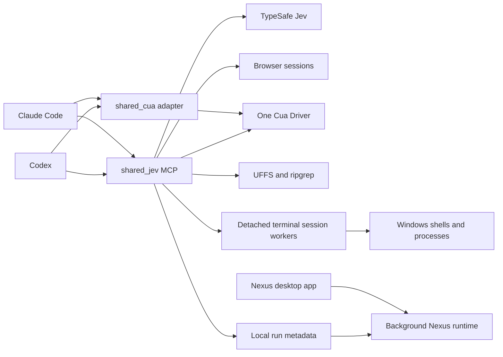
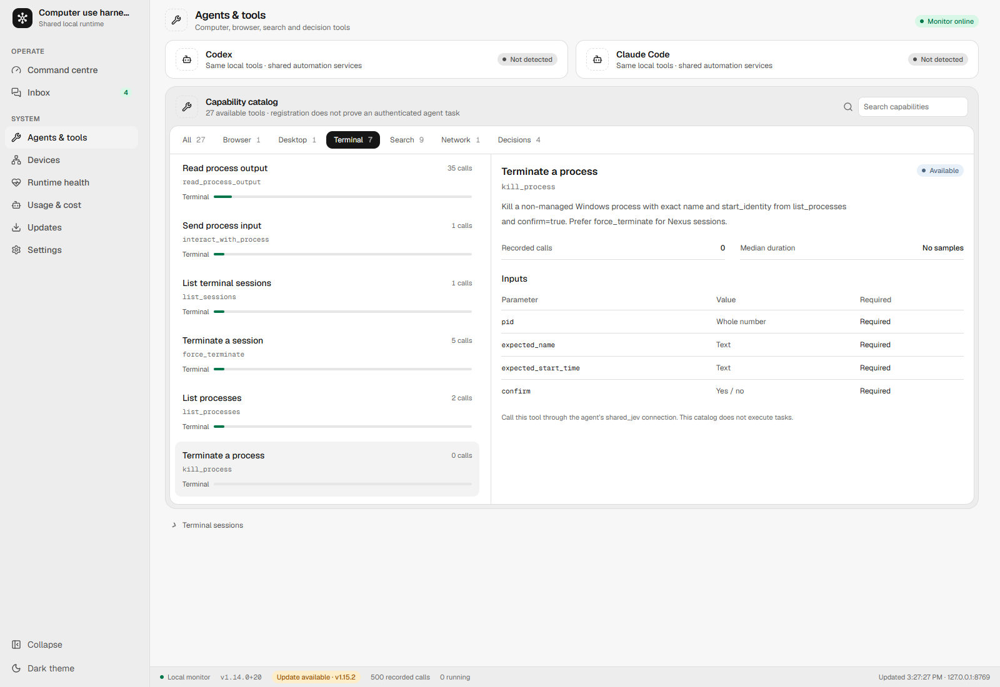
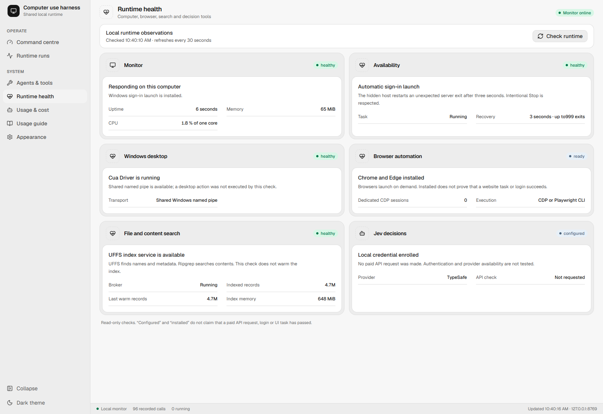
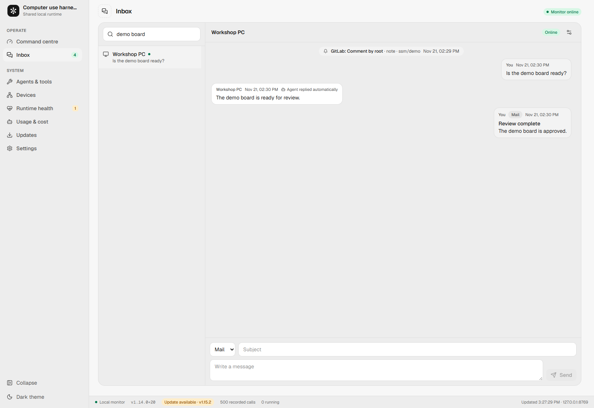
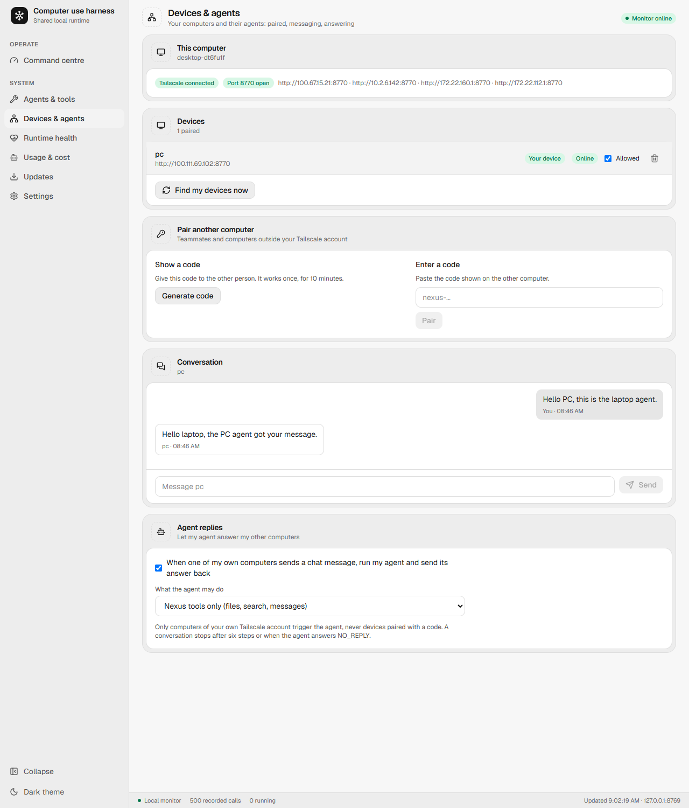
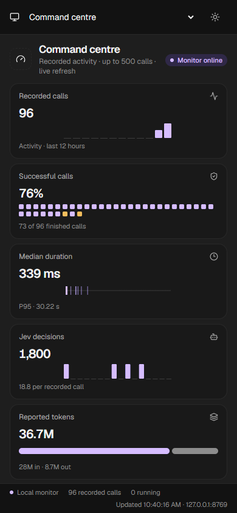

# Nexus Harness

Nexus gives Codex and Claude Code a shared set of Windows tools for finding files, searching text, using browsers and desktop apps, investigating networks, and making bounded decisions with TypeSafe Jev. Its local monitor shows tool activity and component health.

**Start here:** [What to download](#what-to-download) · [Install with the wizard](#install-with-the-wizard) · [Settings](#settings) · [Connect Codex and Claude](#connect-codex-and-claude-code) · [Verify the installation](#verify-the-installation) · [Troubleshooting](#troubleshooting)


## What to download

Get the installer from [GitLab releases](http://10.2.6.112:8080/ssm/shared-computer-use/-/releases) (outside the office, the same server at its [Tailscale address](http://100.110.236.122:8080/ssm/shared-computer-use/-/releases)). GitLab also lists source-code archives; they are not installers.

| Download | What it does |
|---|---|
| **Nexus-Harness-Setup-X.Y.Z-windows-x64.exe** | The one installer. A setup wizard installs the harness, runtimes, skills and the Nexus app, adds Start menu and optional desktop shortcuts with the Nexus icon, starts Nexus at sign-in, and registers Codex and Claude where found. |
| **Deployment ZIP** | Advanced: run `Nexus.Setup.exe repair <installation-directory>` after extraction, or use `Setup.ps1 -EnrollKey` to set up and enroll a key. |
| **SHA256 files** | Checksums for the downloads. |

## Requirements

- Windows 11 x64, an interactive user session, and Windows PowerShell 5.1. The installer needs no administrator rights; the UFFS search broker may ask for approval once.
- Codex and/or Claude Code installed and signed in separately. Nexus does not install or authenticate them.
- Your own TypeSafe API key for Jev-backed tools.
- Chrome or Edge for browser tasks, and the Microsoft Edge WebView2 Runtime for the Nexus window.

Everything else (Node, Cua Driver, UFFS, ripgrep, npm dependencies) is bundled.

Browser tasks that generate text or return written answers also need a text model. For a local model, install and start [Ollama for Windows](https://ollama.com/download/windows), then run `powershell.exe -NoProfile -ExecutionPolicy Bypass -File .\Setup-LocalText.ps1` from the Nexus installation folder. The first run downloads approximately 1 GB. Keep Ollama running when using those browser tasks. A ChatGPT Plus subscription does not provide this model. Jev decisions and answer checks still use the TypeSafe service.

## Install with the wizard

1. Download the installer and compare its hash with the `.sha256` file:

   ```powershell
   (Get-FileHash -LiteralPath "$env:USERPROFILE\Downloads\Nexus-Harness-Setup-X.Y.Z-windows-x64.exe" -Algorithm SHA256).Hash
   ```

2. Run it as the Windows user who will run the agents. Choose a folder outside AppData (default `Documents\Nexus Harness`) and whether to add a desktop shortcut.
3. At the end, leave **Open Nexus Harness** ticked. Open **Settings**, paste your TypeSafe API key and select **Save API key**, then **Set up or repair** if anything is missing.
4. Restart or reconnect Codex and Claude, then follow [Verify the installation](#verify-the-installation).

When a same-user Nexus installation owns the monitor, the installer automatically stops its known Nexus desktop, monitor, and MCP processes, transfers the scheduled monitor task, and continues. It keeps prior folders, credentials, and data. Unrecognized port owners and tasks belonging to another user are never killed; setup stops with a clear error. Silent install: `Nexus-Harness-Setup-X.Y.Z-windows-x64.exe /VERYSILENT /DIR="C:\Nexus"`. Uninstall from Windows **Installed apps**.

## Settings

The Nexus window has a **Settings** screen. It shows the installation folder, saves or replaces the default TypeSafe key, and reruns harness and agent setup. Under **Keys for individual tools**, save a named key, choose a tool and assign the key; choose **Use default key** to remove an assignment. Saving an existing name replaces that key. Keys are encrypted for your Windows account and are never placed in command lines or logs. Reconnect agents after changing keys or assignments.

The optional local text model is configured separately by `Setup-LocalText.ps1`. It creates `jev-browse\.env` without overwriting an existing file. If that file already exists, review its text-model settings before changing them. Environment variables take precedence. The local model may be slower and less reliable on complex pages; review returned information and verify browser actions.

## Connect Codex and Claude Code

Both agents should use the same installed Nexus services:

- `shared_jev` is the Nexus MCP server for the tools below. Each agent can launch its own adapter process.
- `shared_cua` is a direct adapter to the same Cua Driver named pipe; it is not another desktop driver.
- The `shared-harness` skill tells agents when and how to use the tools. It is distinct from the MCP registrations.

### Check automatic setup

The compiled setup helper attempts registration only for agent commands visible on its PATH. It leaves existing entries untouched, which may mean they still point at another installation. Run these checks for the agents you use:

```powershell
codex mcp get shared_jev
codex mcp get shared_cua
claude mcp get shared_jev
claude mcp get shared_cua
```

Check that the executables and `jev-use\start.mjs` resolve to the intended installation. If the `codex` or `claude` command is unavailable, start the appropriate agent CLI or add its supported executable to your shell PATH; installing a skill folder alone does not install an MCP server. On this laptop the Codex CLI can also be invoked as `C:\Users\Admin\.codex\.sandbox-bin\codex.exe`. Paths on another machine may differ.

If setup stopped while checking a missing registration, a laptop validation reported that `codex mcp get` stderr could become a terminating PowerShell `NativeCommandError`; manual registration succeeded there. Inspect the actual error and existing entries first. Do not remove or overwrite another registration blindly.

### Add missing registrations manually

The following examples assume the deployment ZIP location from the installation steps. Change `$nexus` if you installed it elsewhere. Run only the commands for **missing** registrations; investigate an existing entry that points elsewhere before changing it.

```powershell
$nexus = Join-Path $env:USERPROFILE 'Documents\Nexus-Harness\shared-computer-use'
codex mcp add shared_jev -- "$nexus\runtime\node.exe" "$nexus\jev-use\start.mjs"
codex mcp add shared_cua -- "$nexus\runtime\cua-driver.exe" mcp --socket '\\.\pipe\cua-driver'
```

```powershell
$nexus = Join-Path $env:USERPROFILE 'Documents\Nexus-Harness\shared-computer-use'
claude mcp add -s user shared_jev -- "$nexus\runtime\node.exe" "$nexus\jev-use\start.mjs"
claude mcp add -s user shared_cua -- "$nexus\runtime\cua-driver.exe" mcp --socket '\\.\pipe\cua-driver'
```

Inspect both entries again with `mcp get`, then restart or reconnect each agent so it discovers the current server. If setup stopped before completing monitor and skill setup, rerun `powershell.exe -NoProfile -ExecutionPolicy Bypass -File .\Setup.ps1 -EnrollKey` from the harness folder and verify its output. This prompts for the key; omit `-EnrollKey` if it was already enrolled for this installation. Setup installs the packaged skill when it detects each agent's profile folder. To install a missing skill or refresh one managed by this installation:

```powershell
.\Install-Skills.ps1
.\Install-Skills.ps1 -Update
```

The update switch refuses to replace an unrelated or differently managed skill. Point agents to [AGENTS.md](AGENTS.md), [USAGE.md](USAGE.md), and the installed `shared-harness` skill; ask them to use `shared_jev` and `shared_cua` for supported tasks. Registration or a listed tool alone is not proof that the agent can perform an authenticated task.

## Verify the installation

From the installed `shared-computer-use` folder:

```powershell
.\Harness.ps1 tools
.\Harness.ps1 status
.\Harness.ps1 call -Tool find_files -Arguments '{"pattern":"Harness.ps1","kind":"file","limit":10}'
.\Monitor.ps1 Status
.\Diagnose.ps1
```

`tools` lists the live MCP catalog. `status` reports search readiness, not a completed search. The bounded `find_files` query should return an appropriate match on an indexed drive; inspect its status, coverage, truncation and errors. First use can take longer while UFFS starts. Search may legitimately be idle when not in use. An empty result does not prove a file is absent from an uncovered or stale index.

`Diagnose.ps1` checks the catalog, search status, Cua Driver and monitor, and reports whether the default key file exists without decrypting it. It does not authenticate to Jev or perform a UI action. After reconnecting, ask each agent to use a harmless `find_files` query and, where authorized, a bounded browser or Calculator task with an explicit expected result. Confirm the actual returned evidence. Authenticated Jev calls can consume API credit; a successful setup, green monitor, existing key or visible tool name is not an end-to-end test.

For other invocations, use the same implementation through the CLI:

```powershell
.\Harness.ps1 call -Tool jev_browse -Arguments '@browser-task.json'
```

`call` takes the tool name and either inline JSON or `@file.json`; `Harness.ps1` handles Windows PowerShell 5.1 quote stripping itself, so no manual escaping is needed (quote `@file` so PowerShell does not treat it as splatting). `.\Harness.ps1 doctor` runs `Diagnose.ps1`.

If an agent reports `MCP error -32000: Connection closed`, the harness server exited at startup. The CLI now prints the server's own output and the cause; a credential that cannot be decrypted (a `computeruse_1.xml` copied from another Windows user or machine) no longer stops the server, it only disables Jev tools until `Set-ComputerUseKey.ps1` is run. The CLI starts its own server, so it does not prove that an agent's MCP registration or session is connected: reconnect the agent and confirm its `shared_jev` tools are listed and a `search_status` call succeeds. See [USAGE.md](USAGE.md) for the current inputs, examples, limits and expected outcomes.

## Tools

The live `tools` catalog is authoritative. The current baseline is:

| Tool | Use |
|---|---|
| `find_files` | Find file and folder names through the UFFS NTFS metadata index. |
| `search_status` | Inspect index readiness, drive coverage and memory. |
| `search_local` | Search file contents locally, including large files, with bounded results. |
| `nexus_read_file` | Read UTF-8 text files with line pagination, restricted roots and a 48 KiB output cap; does not parse PDF or Office files. |
| `nexus_read_document` | Read text from Word, Excel and PDF files, paged by line, row (per sheet) or page. |
| `nexus_write_file` | Create or (with `overwrite` and an optional content hash) replace a UTF-8 text file atomically inside the write roots. |
| `nexus_edit_file` | Replace exact text in a file only when it occurs the expected number of times. |
| `jev_search_content` | Find scoped text and send selected excerpts to Jev for ranking. |
| `network_probe` | Inspect local network information or explicitly requested hosts, ports, URLs or IPv4 subnet. |
| `start_process` | Start a Windows command in a managed terminal session with a session ID and PID. |
| `read_process_output` | Read bounded output by absolute line offset, including the tail of a session. |
| `interact_with_process` | Queue input for an active terminal session. |
| `list_sessions` | Inspect terminal sessions across Codex, Claude and CLI processes. |
| `force_terminate` | Stop a managed terminal session and its process tree. |
| `nexus_peers` | Connect to other Nexus installations, switch them on/off and set mail/chat permissions. |
| `nexus_mail` | Send and read mail or chat between agents over peer connections; `wait` blocks until a message arrives (realtime). |
| `nexus_webhooks` | Choose which GitLab events and projects the receiver accepts, which notify, and which peers get a copy. |
| `nexus_events` | Poll Nexus events (MCP Events extension; push and webhook delivery are protocol methods): GitLab webhook events and peer messages, with cursors. |
| `list_processes` | Inspect Windows PID, process name, cumulative CPU seconds and working-set memory. |
| `kill_process` | Stop a non-managed process using its PID, exact name, observed start identity and explicit confirmation. |
| `restart_application` | Hand an explicitly authorized graceful application restart to an independent Windows scheduled task. |
| `restart_status` | Read the persisted state of a requested restart after reconnecting. |
| `map_files` | Build file maps, review pages and dry-run organization proposals; it does not move files. |
| `jev_browse` | Run a bounded Chrome or Edge task with an explicit goal and expected text. |
| `browser_read_page` | Read bounded Markdown, text, sanitized HTML, links, or metadata from an existing named Playwright session without interaction. Use hash-guarded page offsets for long content. |
| `web_scrape` | Read public HTTP(S) pages without browser startup; block unsafe destinations and report when browser rendering is needed. |
| `jev_desktop` | Run a bounded accessibility-based Windows task against an identified app and expected state. |
| `jev_select_workflow` | Recommend a workflow for a supplied request. |
| `jev_rank_results` | Rank caller-supplied candidates. |
| `jev_classify_failure` | Classify supplied failure evidence and recommend a recovery. |
| `jev_verify_result` | Judge whether supplied evidence supports a requested outcome. |

Terminal tools use one detached worker per active session, not another always-running service. Session state and up to 4 MiB of retained output are kept in the current Windows user's LocalAppData under `Nexus\terminal-sessions`. Sessions remain usable after an agent's MCP adapter disconnects. The desktop app groups the seven tools under Terminal and displays session registry state, duration and exit code; it does not run commands itself. Completed sessions are kept until a later start prunes records older than seven days. The registry holds up to 64 records. An explicit session ID is safer than a PID after process reuse. Shell input/output uses pipes, not a pseudo-terminal (PTY); programs requiring a real console may not work. Command execution uses the signed-in Windows user's permissions and is **not sandboxed**. Do not send untrusted commands to the terminal or assume a command blocklist prevents harmful operations. `kill_process` requires `confirm=true`, an exact name and the start identity returned by `list_processes`; agents must get user authorization for disruptive changes. The monitor records tool metadata, not command or stdin content. During launch a private local file briefly holds the command; do not put credentials in command arguments. See [USAGE.md](USAGE.md) for limits and detailed contracts.

The four decision tools return judgments or recommendations; they do not execute a workflow or independently observe the application. A null or uncertain result is valid. Give browser and desktop tasks a specific target and end condition. An inaccessible control, ambiguous target, challenge or step limit can stop the task; inspect the actual result rather than assuming success.

`search_local` keeps its search results local; `jev_search_content` can send selected excerpts to TypeSafe. Both have limits and can report truncation, errors or inaccessible files. Neither is general PDF, Office or OCR extraction. `network_probe` only performs requested active probes; a missing ICMP reply does not prove a host is absent. See [USAGE.md](USAGE.md) for scope and limits.

## How the pieces fit



The driver uses `\\.\pipe\cua-driver` in the interactive Windows session. Browser profiles and named sessions are local and separate from personal browser profiles. Named Playwright sessions have cross-process locks; `session_busy` means the session is in use, not permission to delete its lock. When an exact `jev_desktop` target is minimized, Nexus restores it without taking focus and continues; a visible window does not by itself prove the correct browser profile or authentication. Serialize desktop and legacy CDP requests across agents; their arbitration is not complete. Use an existing API for deterministic operations and Nexus tools for the supported computer-use and search tasks.

`shared_jev` also publishes its packaged agent skill over MCP using the official Skills extension (`io.modelcontextprotocol/skills`): a client that implements it can list, verify and read `shared-harness` straight from the server, with nothing extra to install. `Install-Skills.ps1` still copies the same skill to Codex and Claude Code for hosts that do not. See [USAGE.md](USAGE.md#skills-over-mcp) for the protocol surface.

## Desktop app and background runtime

Open **Nexus Harness** from the Windows Start menu. The installed interface opens only in the desktop app. From the harness folder, these commands check or start the background runtime:

```powershell
.\Monitor.ps1 Status
.\Harness.ps1 monitor
```

The desktop app shows recorded runs, timings, token and estimated-cost information, the tool catalog, and runtime health. It reads up to 500 calls from a 256 KiB log tail. Refresh and component observations have different intervals. Missing usage is unknown. Direct Cua actions outside the wrapper may not appear in recorded calls.

Incoming peer messages, configured GitLab events, and available updates use native Windows notifications under **Nexus**. The **Open Inbox** and **Open Updates** actions bring the desktop app to the relevant view. Windows notification settings control how Nexus alerts are displayed.

| Capability catalog | Runtime health |
|  |  |

**Inbox** is the messaging page: a searchable list of paired computers with unread counts and previews, and a thread that fills the window, scrolls inside itself and keeps the composer in place. Forwarded GitLab events show as one line, never as raw JSON. **Devices** manages the computers: this computer's network state and responder defaults, and one table of paired computers with enable, mail, chat, auto-reply and autonomy controls. Pair a computer opens the code form in place. Your own computers pair automatically over Tailscale. Teammates pair with a one-time code. **Agents & tools** lists the registered agents and the capability catalog; Terminal sessions stay closed, and are not fetched, until you open them. See [USAGE.md](USAGE.md) for responder settings and delivery behavior.

GitLab pipeline event summaries include a bounded pipeline ID, short commit SHA, duration, individual completed-job durations, and failed job names when GitLab supplies them. The full job trace remains in GitLab; the monitor does not store raw CI logs.

Feature-branch pushes use the B19CL3PC runner for `validate-branch`. Newer pushes automatically cancel obsolete branch validation and preview jobs. `CI-Validate.ps1` measures npm restore, package checks, an actual read-only MCP tool call, and headless tests. It uploads `ci-evidence/validation.json` and a JUnit test report, including on failure. A commit labeled `[preview-build]` also requests `CI-Preview.ps1`, which builds a temporary ZIP and installer and checks their sizes and SHA-256 hashes. Its `ci-evidence/preview.json` report and verified packages remain temporary GitLab artifacts. These jobs reuse pinned CI tools and never change installed Nexus versions. `release` on `main` is non-interruptible and remains the only job that publishes GitLab releases and updates the GitHub mirror. A branch preview is not a release or an update signal.

|  |  |
|---|---|
|  |  |

<details><summary>More monitor views</summary>




</details>

The screenshots show a particular local run; counts and health differ on each machine. [UI provenance](monitor-ui/PROVENANCE.md) describes the reused components.

`SharedHarness-Monitor` starts the hidden runtime at user sign-in and restarts an unexpected server exit after three seconds. It supplies the local API, webhooks, peer mail and updates. Status checks continue to use the loopback API. An intentional stop suppresses recovery for that stop while preserving the next sign-in task:

```powershell
.\Monitor.ps1 Stop
```

The wizard copies the payload and calls the self-contained `Nexus.Setup.exe` for preflight and provisioning. The same helper handles Settings repair and packaged ZIP setup. It validates runtime checksums and the dependency lock, transfers only the verified monitor and processes, and checks Task Scheduler and the running monitor before reporting success. The interactive installer requests administrator approval if Windows denies access to a verified monitor task or the task belongs to another Windows user. Only takeover runs elevated. Setup still runs under the account that launched the installer. Silent upgrades report the privilege failure without displaying a prompt. If Windows denies takeover even with administrator approval, the previous owner can stop and remove their Nexus startup task before retrying. A responding monitor is not proof that a browser, search, desktop action or paid Jev request works. Its read-only server binds to loopback; the separate `map_files` review server has different behavior and port.

When interpreting an empty `find_files` result, check the requested drive's `coverage.state`. An uncovered or loading drive cannot confirm absence.

## Keys, privacy and cost

The default key is stored in `secrets\computeruse_1.xml`, encrypted with Windows DPAPI for the current Windows account. Do not put key values in source control, release bundles, logs or instructions. Keep the installation's secrets, browser profiles, sessions and run history on the same account and machine unless deliberately migrated. Codex and Claude authentication is separate from the TypeSafe key.

Use Nexus Settings to save named keys and assign them to tools. As an alternative, optional per-tool aliases can be configured from PowerShell. Enroll each alias at a masked prompt:

```powershell
.\Set-ComputerUseKey.ps1 -Alias browser_team
.\Set-ComputerUseKey.ps1 -Alias decisions_team
```

Create `secrets\tool-keys.json` with aliases, never key values:

```json
{
  "jev_browse": "browser_team",
  "jev_desktop": "browser_team",
  "jev_verify_result": "decisions_team"
}
```

Unmapped tools use the default key. An invalid or missing mapped alias fails the relevant call rather than silently choosing another key. Reconnect agents after enrollment or mapping changes. Runtime health reports default enrollment, not successful authentication or the health of every mapping. Actual multi-key live authentication has not been established by the release checks.

Jev-backed requests can send task descriptions, selected control state and excerpts to TypeSafe; provide only information appropriate for the task. The monitor's compact wrapper metadata does not record task text, field values, screenshots or keys. A monitor cost estimate can be partial and excludes other providers.

## Updates and rollback

In the desktop app, open **Updates** and select **Update now**. Nexus displays the download progress, verifies the release checksum, then opens the Windows Setup wizard. Continue there to see installation progress. If Windows blocks access to the verified Nexus monitor task, choose **Run as administrator** in Setup to retry that step and approve the Windows prompt. The rest of setup uses the original Windows account. Manual installer diagnostics are in `%LOCALAPPDATA%\Nexus\manual-update.log`.

To roll back, choose an older release in **Versions**. A rollback turns off automatic updates so the newer release is not immediately reinstalled. Reconnect agents after the upgrade or rollback to use the updated tools. Source and ZIP deployments are updated separately from the installer-managed app.

## Troubleshooting

| Symptom | What to check |
|---|---|
| Desktop EXE says the monitor could not open | Run `.\Monitor.ps1 Status` from the harness folder, then `Start` if appropriate. Confirm `SharedHarness-Monitor` belongs to this installation and WebView2 Runtime is available. |
| Monitor is unavailable or startup times out | Inspect the task state, its last result and `monitor-error.log`. Another installation may own the task or port; preserve it until you decide how to migrate. |
| Monitor runs outside its managed task | For the same installation, stop it with `.\Monitor.ps1 Stop`, then run `.\Monitor.ps1 InstallStartup`; inspect ownership first. |
| Codex or Claude cannot see a tool | Check `mcp get` for `shared_jev` and `shared_cua`, their launcher paths, the installed skill, and whether the agent has been reconnected. |
| Setup stops on a missing Codex registration | Inspect the error and entries; the reported PowerShell `NativeCommandError` case and manual registration commands are described above. |
| Jev key is missing or rejected | Enroll the key using the masked prompt and reconnect the MCP process. Key presence does not establish successful authentication. Never paste it into diagnostics. |
| Search shows idle or returns no match | Run a bounded search and check drive coverage, freshness and errors. UFFS may be parked or still warming; absence from an uncovered drive is not proof of absence. |
| Browser or desktop task does not complete | Inspect the returned reason, target, expected result, challenge, step limit and time limit. A successful synthetic form does not prove every site or desktop application works. |
| Source setup refuses existing `node_modules` | It intentionally preserves unverified or changed dependencies. Stop agents using the installation and use a fresh checkout; do not run `npm ci` over an active directory. |
| A component was installed but is not found | Reconnect the shell/agent and inspect its PATH. Source setup can also find the standard UFFS WinGet package path. |

## Source, development and release

GitLab [Nexus Harness](http://10.2.6.112:8080/ssm/shared-computer-use) is the development upstream; its repository path remains `ssm/shared-computer-use`. A separate public source snapshot is available at [GitHub: Nexus](https://github.com/bhadkamkar9snehil/Nexus). GitLab runs CI; GitHub has no CI or automatic synchronization. Screenshot links are relative on both hosts.

For source setup, install Git, Node 22 or later, npm, Codex and/or Claude, and the Windows prerequisites. Clone the repository to an ordinary folder outside AppData, then from the checkout:

```powershell
.\Install.ps1 -InstallDriver -InstallSearch -RegisterAgents
.\Set-ComputerUseKey.ps1
.\Install-Skills.ps1
.\Monitor.ps1 InstallStartup
```

Source setup stages dependency restoration and preserves a conflicting existing `node_modules`. The same registration checks, reconnects and actual workflow verification apply. The source is not the deployment ZIP; it does not bundle all runtimes by itself.

The desktop host source is in `desktop/`. Building it requires the .NET 10 SDK; running it requires WebView2 and an existing monitor. The published EXE is a separate release asset. A source build is not an installer:

```powershell
dotnet build .\desktop\Nexus.Desktop.csproj --configuration Release
```

For changes, run the relevant package, reference and UI checks; see [VALIDATION.md](VALIDATION.md). `Test-Package.ps1` checks TypeScript, monitor syntax and MCP discovery. `npm --prefix jev-use test` runs the reference/unit suite. `Publish-Desktop.ps1 -PayloadDir <folder>` publishes outside the source tree and checks the resulting assembly and copied payload for its startup and window classes; CI runs this check as well. Rendered monitor checks and live browser/desktop probes are separate and may interact with apps or spend API credit. Clean teammate-machine setup, real authenticated tasks from both agents, and signed-in browser persistence still require destination acceptance.

Build releases from verified GitLab main with `Build-Deployment.ps1 -Version X.Y.Z -Installer`. The script stages source, restores dependencies, builds the monitor, verifies runtimes, and reports elapsed time for each stage. Verify ZIP extraction with bundled Node, then publish the verified installer and checksum to GitLab and GitHub at the release tag.

The monitor checks published GitHub releases every ten minutes on installed copies, even when the desktop app is closed. It falls back to GitLab release metadata over Tailscale or the office network. With a saved GitLab token, it first tries downloading the matching public release installer over the office network and verifies it against the same published SHA-256 before use. The public download works without a GitLab token.

Automatic setup runs only after five minutes without keyboard or mouse input, with no tool call or installer running. Nexus backs up keys and tool assignments before scheduling a one-off install in the current Windows session. **Install updates automatically when I am away** is on by default. Turn it off in Updates or set `autoUpdate` to false in `%LOCALAPPDATA%\Nexus\updates.json`. A manual rollback also turns it off. Check `%LOCALAPPDATA%\Nexus\auto-update.log` for download and scheduled installation results, and `setup.log` in the same folder for installer diagnostics. If Windows blocks an unattended install on permissions, use **Update now** and approve the administrator retry in Setup.

Further references: [operator and tool contracts](USAGE.md) · [agent instructions](AGENTS.md) · [validation and limits](VALIDATION.md) · [third-party software](THIRD_PARTY.md) · [search research](SEARCH-RESEARCH.md).
